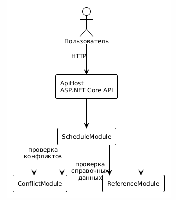

# Курсовое проектирование. Этап 1  
## Разработка перечня артефактов и протоколов проекта

**Тема курсового проекта:** «Разработка системы электронного расписания образовательной организации»

**МДК:** 02.02 «Инструментальные средства разработки программного обеспечения»  
**Стек:** C# / .NET 9, Git  
**Тип приложения:** веб-приложение с серверной частью на ASP.NET Core

---

# 1. Исходное состояние проекта

Перед началом выполнения этапа был создан Git-репозиторий курсового проекта.

Исходное состояние было проверено командой:

```bash
git status
```

Текущая ветка:

```text
main
```

Для выполнения этапа создана отдельная ветка:

```bash
git checkout -b docs/project-artifacts
```

В рамках данного этапа выполняется проектирование структуры программной системы и подготовка проектной документации.

---

# 2. Назначение и границы проекта

## 2.1. Назначение системы

Разрабатываемая программная система предназначена для хранения, просмотра и формирования электронного расписания занятий образовательной организации.

Пользователь системы должен иметь возможность:

- просматривать расписание занятий по учебной группе;
- просматривать расписание по преподавателю;
- просматривать расписание по аудитории;
- просматривать расписание по дисциплине;
- фильтровать занятия по дате, группе, преподавателю, аудитории;
- получать информацию о времени, месте и типе занятия;
- видеть изменения в расписании;
- просматривать опубликованное расписание.

Сотрудник учебного отдела должен иметь возможность:

- вести справочник учебных групп;
- вести справочник преподавателей;
- вести справочник дисциплин;
- вести справочник аудиторий;
- создавать, изменять и отменять занятия;
- проверять конфликты при формировании расписания;
- публиковать расписание;
- переносить занятия с контролем конфликтов;
- просматривать расписание по различным критериям.

---

## 2.2. Основные объекты предметной области

В системе выделены следующие основные сущности:

- учебная группа;
- преподаватель;
- дисциплина;
- аудитория;
- занятие;
- временной слот;
- учебный период;
- тип занятия;
- конфликт расписания.

Примеры аудиторий:

- 101;
- 202;
- 301.

---

## 2.3. Границы проекта

### В систему входит

1. Ведение справочника учебных групп.
2. Ведение справочника преподавателей.
3. Ведение справочника дисциплин.
4. Ведение справочника аудиторий.
5. Создание и редактирование занятий.
6. Просмотр расписания по группе, преподавателю, аудитории и дисциплине.
7. Проверка конфликтов при формировании расписания.
8. Проверка занятости преподавателя.
9. Проверка занятости учебной группы.
10. Проверка занятости аудитории.
11. Публикация расписания.
12. Отмена и перенос занятий.
13. Хранение истории изменений расписания в базовом объёме.

### В систему не входит

В рамках курсового проекта не реализуются:

- автоматическое составление расписания с помощью генетических алгоритмов;
- интеграция с внешними системами деканата;
- интеграция с 1С:Университет;
- расчёт учебной нагрузки и тарификации преподавателей;
- автоматическая отправка SMS и email-уведомлений;
- мобильное приложение;
- личные кабинеты с внешней авторизацией;
- учёт экзаменационной сессии;
- построение оптимальных маршрутов между корпусами.

Эти функции могут быть добавлены при дальнейшем развитии проекта.

---

# 3. Реестр проектных артефактов

Для проекта сформирован следующий перечень артефактов.

| № | Артефакт | Назначение | Расположение |
|---:|---|---|---|
| 1 | Описание назначения и границ проекта | Определяет функции и ограничения системы | `docs/project-scope.md` |
| 2 | Перечень модулей | Описывает состав системы и ответственность модулей | `docs/modules.md` |
| 3 | Архитектурная схема | Показывает структуру и связи модулей | `docs/architecture.md` |
| 4 | Перечень зависимостей | Фиксирует внутренние и внешние зависимости | `docs/dependencies.md` |
| 5 | Контракты взаимодействия | Определяет правила обмена между модулями | `docs/contracts.md` |
| 6 | DTO | Определяет структуры передаваемых данных | `src/Contracts/` |
| 7 | Инструкция сборки и запуска | Позволяет другому разработчику запустить проект | `README.md` |
| 8 | Тестовая стратегия | Определяет порядок проверки системы | `docs/testing.md` |
| 9 | Правила работы с Git | Определяет правила ветвления и коммитов | `docs/version-control.md` |
| 10 | Журнал технических решений | Фиксирует значимые архитектурные решения | `docs/decisions/` |

---

# 4. Перечень модулей системы

В проекте выделено четыре основных функциональных модуля.

| Модуль | Ответственность |
|---|---|
| `ScheduleModule` | Хранение и просмотр расписания, создание, изменение, отмена и публикация занятий |
| `ConflictModule` | Проверка конфликтов по преподавателю, учебной группе и аудитории |
| `ReferenceModule` | Ведение справочников групп, преподавателей, дисциплин и аудиторий |

Дополнительно используется `ApiHost`, который принимает запросы от пользовательского интерфейса и передает их соответствующим модулям.

---

## 4.1. ScheduleModule

Отвечает за расписание занятий.

Основные функции:

- получение расписания по фильтрам;
- получение информации о занятии;
- создание занятия;
- изменение занятия;
- отмена занятия;
- перенос занятия;
- публикация расписания;
- проверка конфликтов через ConflictModule;
- проверка справочных данных через ReferenceModule.

Пример состояний занятия:

```text
Draft
Published
Cancelled
Moved
```

---

## 4.2. ConflictModule

Отвечает за проверку конфликтов при формировании расписания.

Основные функции:

- проверка занятости преподавателя;
- проверка занятости учебной группы;
- проверка занятости аудитории;
- проверка корректности временного интервала;
- исключение текущего занятия при редактировании;
- возврат списка найденных конфликтов.

Пример типов конфликтов:

```text
TeacherConflict
GroupConflict
RoomConflict
InvalidTimeRange
```

---

## 4.3. ReferenceModule

Отвечает за работу со справочниками.

Основные функции:

- ведение учебных групп;
- ведение преподавателей;
- ведение дисциплин;
- ведение аудиторий;
- получение справочной информации;
- проверка существования ссылочных сущностей;
- поиск по справочникам.

---

# 5. Архитектурная схема

Для проекта выбрана модульная архитектура.



Центральным модулем бизнес-процесса является `ScheduleModule`.

При создании заказа он:

1. получает справочные данные;
2. проверяет существование группы, преподавателя, дисциплины и аудитории;
3. проверяет конфликты;
4. сохраняет занятие;
5. при необходимости публикует расписание.

---

# 6. Предполагаемая структура решения

```text
ElectronicSchedule/
│
├── src/
│   │
│   ├── ElectronicSchedule.Api/
│   ├── ElectronicSchedule.Schedule/
│   ├── ElectronicSchedule.Conflicts/
│   ├── ElectronicSchedule.Reference/
│   └── ElectronicSchedule.Contracts/
│
├── tests/
│   │
│   ├── ElectronicSchedule.UnitTests/
│   └── ElectronicSchedule.IntegrationTests/
│
├── docs/
│   │
│   ├── project-scope.md
│   ├── modules.md
│   ├── architecture.md
│   ├── dependencies.md
│   ├── contracts.md
│   ├── testing.md
│   ├── version-control.md
│   │
│   └── decisions/
│       ├── ADR-001-modular-architecture.md
│       └── ADR-002-module-contracts.md
│
├── .gitignore
├── .editorconfig
├── README.md
└── ElectronicSchedule.sln
```

---

# 7. Внутренние зависимости

Внутренние зависимости определяют взаимодействие проектов внутри решения.

```text
Api
 ↓
Schedule
 ↓
Contracts

Api
 ↓
Conflicts
 ↓
Contracts

Api
 ↓
Reference
 ↓
Contracts
```

При этом бизнес-модули не должны напрямую обращаться к внутренним классам друг друга.

Взаимодействие выполняется через публичные контракты.

Например:

```text
ScheduleModule
      ↓
IConflictCheckService
      ↓
ConflictModule
```

```text
ScheduleModule
      ↓
IReferenceDataService
      ↓
ReferenceModule
```

Это позволяет уменьшить связанность модулей.

---

# 8. Внешние зависимости

На этапе проектирования предполагается использование следующих внешних компонентов.

| Зависимость | Назначение |
|---|---|
| .NET 9 | Платформа выполнения |
| ASP.NET Core | Разработка серверного API |
| Entity Framework Core | Доступ к данным |
| SQLite | Хранение данных в учебной версии проекта |
| xUnit | Модульное тестирование |
| Git | Контроль версий |
| OpenAPI / Swagger | Документирование API |

Конкретные версии библиотек должны быть зафиксированы в файлах проекта.

---

# 9. Основные DTO проекта

Для передачи данных между слоями и модулями создаются DTO.

## 9.1. GroupDto

```csharp
public record GroupDto(
    Guid Id,
    string Code,
    string Name,
    int Course,
    string Faculty
);
```

---

## 9.2. TeacherDto

```csharp
public record TeacherDto(
    Guid Id,
    string FullName,
    string Department,
    string Email
);
```

---

## 9.3. DisciplineDto

```csharp
public record DisciplineDto(
    Guid Id,
    string Code,
    string Name,
    string Department
);
```

---

## 9.4. RoomDto

```csharp
public record RoomDto(
    Guid Id,
    string Number,
    string Building,
    int Capacity,
    string RoomType
);
```

---

## 9.5. LessonDto

```csharp
public record LessonDto(
    Guid Id,
    Guid GroupId,
    Guid TeacherId,
    Guid DisciplineId,
    Guid RoomId,
    DateOnly Date,
    TimeOnly StartTime,
    TimeOnly EndTime,
    string LessonType,
    string Status
);
```

---

## 9.6. CreateLessonRequest

```csharp
public record CreateLessonRequest(
    Guid GroupId,
    Guid TeacherId,
    Guid DisciplineId,
    Guid RoomId,
    DateOnly Date,
    TimeOnly StartTime,
    TimeOnly EndTime,
    string LessonType
);
```

---

## 9.7. CheckConflictRequest

```csharp
public record CheckConflictRequest(
    Guid? LessonId,
    Guid GroupId,
    Guid TeacherId,
    Guid RoomId,
    DateOnly Date,
    TimeOnly StartTime,
    TimeOnly EndTime
);
```

---

## 9.8. ConflictCheckResult

```csharp
public record ConflictCheckResult(
    bool Success,
    string? ErrorCode,
    IReadOnlyList<ConflictDto> Conflicts
);
```

---

## 9.9. ConflictDto

```csharp
public record ConflictDto(
    string Type,
    Guid? ConflictingLessonId,
    string Description
);
```

---

## 9.10. ValidateLessonReferencesRequest

```csharp
public record ValidateLessonReferencesRequest(
    Guid GroupId,
    Guid TeacherId,
    Guid DisciplineId,
    Guid RoomId
);
```

---

## 9.11. ReferenceValidationResult

```csharp
public record ReferenceValidationResult(
    bool Success,
    string? ErrorCode
);
```

---

# 10. Описание API

Клиентское приложение взаимодействует с системой через HTTP API.

Предполагаются следующие основные точки входа.

| Метод | Адрес | Назначение |
|---|---|---|
| `GET` | `/api/groups` | Получение списка учебных групп |
| `GET` | `/api/teachers` | Получение списка преподавателей |
| `GET` | `/api/disciplines` | Получение списка дисциплин |
| `GET` | `/api/rooms` | Получение списка аудиторий |
| `GET` | `/api/schedule` | Получение расписания по фильтрам |
| `GET` | `/api/schedule/lessons/{id}` | Получение занятия |
| `POST` | `/api/schedule/lessons` | Создание занятия |
| `PUT` | `/api/schedule/lessons/{id}` | Изменение занятия |
| `DELETE` | `/api/schedule/lessons/{id}` | Отмена занятия |
| `POST` | `/api/schedule/check-conflicts` | Проверка конфликтов |
| `POST` | `/api/schedule/publish` | Публикация расписания |

Контракт API на последующих этапах может быть дополнительно описан средствами OpenAPI.

---

# 11. Протокол взаимодействия № 1  
## Создание и изменение занятия

### 11.1. Инициатор и получатель

**Инициатор:**

```text
ScheduleModule
```

**Получатель:**

```text
ConflictModule
```

---

### 11.2. Назначение

Протокол используется при создании или изменении занятия.

Перед сохранением занятия необходимо убедиться, что преподаватель, учебная группа и аудитория свободны в указанный временной интервал.

---

### 11.3. Механизм вызова

Асинхронный вызов через интерфейс C#:

```csharp
IConflictCheckService
```

Зависимость передается через механизм Dependency Injection.

---

### 11.4. Точка входа

```csharp
Task<ConflictCheckResult> CheckAsync(
    CheckConflictRequest request,
    CancellationToken cancellationToken);
```

---

### 11.5. Формат запроса

```json
{
  "lessonId": null,
  "groupId": "1a2b3c4d-1111-2222-3333-444455556666",
  "teacherId": "2b3c4d5e-2222-3333-4444-555566667777",
  "roomId": "3c4d5e6f-3333-4444-5555-666677778888",
  "date": "2026-10-01",
  "startTime": "09:00:00",
  "endTime": "10:30:00"
}
```

---

### 11.6. Успешный ответ

```json
{
  "success": true,
  "errorCode": null,
  "conflicts": []
}
```

---

### 11.7. Ошибки

Возможные ошибки:

| Код | Описание |
|---|---|
| `TEACHER_CONFLICT` | Преподаватель занят в указанное время |
| `GROUP_CONFLICT` | Учебная группа занята в указанное время |
| `ROOM_CONFLICT` | Аудитория занята в указанное время |
| `INVALID_TIME_RANGE` | Некорректный временной интервал |

Пример:

```json
{
  "success": false,
  "errorCode": "ROOM_CONFLICT",
  "conflicts": [
    {
      "type": "Room",
      "conflictingLessonId": "4d5e6f70-4444-5555-6666-777788889999",
      "description": "Аудитория занята в указанное время"
    }
  ]
}
```

---

### 11.8. Таймаут

Операция должна завершиться не более чем за:

```text
3 секунды
```

При отмене запроса используется `CancellationToken`.

---

### 11.9. Повторная отправка

Автоматический повтор операции проверки конфликтов не выполняется.

Причина: между первой и повторной проверкой состояние расписания могло измениться.

Повтор операции выполняется только после уточнения данных или повторного открытия формы редактирования занятия.

---

### 11.10. Аутентификация

Дополнительная аутентификация между модулями не выполняется, поскольку они работают внутри одного серверного приложения.

Проверка прав пользователя выполняется на уровне API.

---

### 11.11. Версия контракта

```text
ScheduleConflictContract v1
```

---

### 11.12. Пример обмена

```text
ScheduleModule
      │
      │ CheckAsync(...)
      ▼
ConflictModule
      │
      │ Проверка преподавателя
      │
      │ Проверка группы
      │
      │ Проверка аудитории
      │
      │ Проверка времени
      ▼
ConflictCheckResult
      │
      ▼
ScheduleModule
```

При успешной проверке ScheduleModule продолжает сохранение занятия.

При наличии конфликта занятие не сохраняется.

---

# 12. Протокол взаимодействия № 2  
## Проверка перед созданием занятия

### 12.1. Инициатор и получатель

**Инициатор:**

```text
ScheduleModule
```

**Получатель:**

```text
ReferenceModule
```

---

### 12.2. Назначение

Перед созданием или изменением занятия необходимо убедиться, что учебная группа, преподаватель, дисциплина и аудитория существуют в справочниках.

---

### 12.3. Механизм вызова

Асинхронный вызов через интерфейс:

```csharp
IReferenceDataService
```

---

### 12.4. Точка входа

```csharp
Task<ReferenceValidationResult> ValidateAsync(
    ValidateLessonReferencesRequest request,
    CancellationToken cancellationToken);
```

---

### 12.5. Формат запроса

```json
{
  "groupId": "1a2b3c4d-1111-2222-3333-444455556666",
  "teacherId": "2b3c4d5e-2222-3333-4444-555566667777",
  "disciplineId": "5e6f7081-5555-6666-7777-888899990000",
  "roomId": "3c4d5e6f-3333-4444-5555-666677778888"
}
```

---

### 12.6. Успешный ответ

```json
{
  "success": true,
  "errorCode": null
}
```

---

### 12.7. Ошибки

| Код | Описание |
|---|---|
| `GROUP_NOT_FOUND` | Учебная группа не найдена |
| `TEACHER_NOT_FOUND` | Преподаватель не найден |
| `DISCIPLINE_NOT_FOUND` | Дисциплина не найдена |
| `ROOM_NOT_FOUND` | Аудитория не найдена |

Пример ошибки:

```json
{
  "success": false,
  "errorCode": "TEACHER_NOT_FOUND"
}
```

---

### 12.8. Таймаут

Максимальное ожидаемое время выполнения:

```text
2 секунды
```

---

### 12.9. Повторная отправка

Повторный запрос допускается, так как операция не изменяет состояние системы.

Запрос может быть повторён при временной ошибке доступа к справочнику.

---

### 12.10. Аутентификация

Внутренняя аутентификация между модулями не требуется.

Доступ к операции проверки справочных данных предварительно проверяется на уровне API.

---

### 12.11. Версия контракта

```text
ReferenceContract v1
```

---

### 12.12. Пример обмена

```text
ScheduleModule
      │
      │ ValidateAsync(...)
      ▼
ReferenceModule
      │
      │ Проверка группы
      │
      │ Проверка преподавателя
      │
      │ Проверка дисциплины
      │
      │ Проверка аудитории
      ▼
ReferenceValidationResult
      │
      ▼
ScheduleModule
```

---

# 13. Общий сценарий создания занятия

После определения двух протоколов полный процесс создания занятия выглядит следующим образом:

```text
Пользователь
  │
  │ Создаёт занятие
  ▼
ApiHost
  │
  ▼
ScheduleModule
  │
  ├──────────────► ReferenceModule
  │                 Проверка группы,
  │                 преподавателя,
  │                 дисциплины,
  │                 аудитории
  │
  ├──────────────► ConflictModule
  │                 Проверка конфликтов
  │                 по преподавателю,
  │                 группе и аудитории
  │
  │
  │ Сохранение занятия
  │
  ▼
LessonDto
```

Результатом операции является созданное занятие с проверенными справочными данными и отсутствием конфликтов.

---

# 14. Инструкция сборки и запуска

## Требования

Для запуска проекта необходимы:

- .NET SDK 9;
- Git.

Проверка версии .NET:

```bash
dotnet --version
```

---

## Получение проекта

```bash
git clone <адрес-репозитория>
cd ElectronicSchedule
```

---

## Восстановление зависимостей

```bash
dotnet restore
```

---

## Сборка

```bash
dotnet build
```

---

## Выполнение тестов

```bash
dotnet test
```

---

## Запуск

```bash
dotnet run --project src/ElectronicSchedule.Api
```

После запуска API становится доступно по адресу, указанному приложением в консоли.

---

# 15. Тестовая стратегия

Для проекта предусматриваются три уровня проверки.

## 15.1. Модульные тесты

Модульные тесты должны проверять отдельные правила предметной области.

Примеры:

### Тест 1

Занятие не пересекается с другими занятиями.

**Ожидаемый результат**: конфликты не найдены.

### Тест 2

Преподаватель уже занят в указанное время.

**Ожидаемый результат:**

```text
TEACHER_CONFLICT
```

### Тест 3

Аудитория уже занята в указанное время.

**Ожидаемый результат:**

```text
ROOM_CONFLICT
```

### Тест 4

Дата или время занятия указаны некорректно.

**Ожидаемый результат:**

```text
INVALID_TIME_RANGE
```

### Тест 5

Учебная группа уже имеет занятие в указанное время.

**Ожидаемый результат:**

```text
GROUP_CONFLICT
```

---

## 15.2. Интеграционные тесты

Интеграционные тесты должны проверять взаимодействие модулей.

### Сценарий 1. Успешное создание занятия

```text
ScheduleModule
    ↓
ReferenceModule
    ↓
ConflictModule
    ↓
ScheduleModule
```

Ожидается:

- справочные данные найдены;
- конфликты отсутствуют;
- занятие сохранено.

### Сценарий 2. Конфликт аудитории

Ожидается:

- справочные данные найдены;
- обнаружен конфликт аудитории;
- занятие не сохранено.

### Сценарий 3. Получение расписания группы

Ожидается:

- возвращён список занятий выбранной группы;
- занятия отсортированы по дате и времени.

---

## 15.3. Проверка сборки

После внесения изменений должны выполняться:

```bash
dotnet build
dotnet test
```

Критерием успешного результата является отсутствие ошибок сборки и прохождение всех автоматических тестов.

---

# 16. Правила ведения репозитория

Для проекта используются следующие основные ветки:

```text
main
develop
feature/*
fix/*
docs/*
```

## main

Содержит стабильную версию проекта.

## develop

Используется для объединения результатов разработки.

## feature/*

Используется для разработки новых функций.

Примеры:

```text
feature/schedule-crud
feature/conflict-check
feature/reference-management
feature/schedule-view
```

## fix/*

Используется для исправления дефектов.

Например:

```text
fix/conflict-time-validation
fix/schedule-filter
```

## docs/*

Используется при значительных изменениях документации.

Например:

```text
docs/project-artifacts
```

---

# 17. Правила коммитов

Один коммит должен содержать одно логически завершенное изменение.

Используются следующие обозначения:

```text
feat: новая функциональность
fix: исправление
docs: документация
test: тесты
refactor: изменение структуры кода
chore: техническое изменение
```

Примеры:

```text
docs: add project scope
docs: add architecture diagram
docs: describe module contracts
feat: add schedule DTOs
test: add conflict validation tests
```

Не допускаются малоинформативные сообщения:

```text
update
fix
work
123
изменения
```

---

# 18. Журнал технических решений

Для значимых решений проекта используется каталог:

```text
docs/decisions/
```

Каждое решение оформляется отдельным документом.

---

## ADR-001. Использование модульной архитектуры

### Статус

Принято.

### Проблема

Необходимо разделить функции системы таким образом, чтобы изменение логики проверки конфликтов не приводило к изменению справочников или модуля отображения расписания.

### Решение

Разделить приложение на функциональные модули:

```text
Schedule
Conflicts
Reference
```

### Причина

Такое разделение позволяет:

- определить ответственность компонентов;
- уменьшить связанность;
- независимо тестировать бизнес-логику;
- упростить последующее расширение проекта.

---

## ADR-002. Взаимодействие через контракты

### Статус

Принято.

### Проблема

Прямое обращение одного модуля к внутренним классам другого увеличивает связанность приложения.

### Решение

Взаимодействие модулей выполнять через публичные интерфейсы и DTO.

Например:

```text
ScheduleModule
        ↓
IConflictCheckService
        ↓
ConflictModule
```

```text
ScheduleModule
        ↓
IReferenceDataService
        ↓
ReferenceModule
```

### Последствия

Положительные:

- модули слабее связаны;
- проще выполнять тестирование;
- контракт взаимодействия можно изменить контролируемо.

Отрицательные:

- необходимо поддерживать дополнительные DTO и интерфейсы.

---

# 19. Проверка выполнения этапа

После подготовки проектных артефактов была выполнена самопроверка.

| Требование | Результат |
|---|---|
| Описано назначение проекта | Выполнено |
| Определены границы проекта | Выполнено |
| Выделены модули | Выполнено |
| Описана ответственность модулей | Выполнено |
| Подготовлена архитектурная схема | Выполнено |
| Определены внутренние зависимости | Выполнено |
| Определены внешние зависимости | Выполнено |
| Описан API | Выполнено |
| Созданы модели DTO | Выполнено |
| Описаны минимум два протокола | Выполнено |
| Подготовлена инструкция запуска | Выполнено |
| Подготовлена тестовая стратегия | Выполнено |
| Определены правила Git | Выполнено |
| Создан журнал технических решений | Выполнено |

---

# 20. Изменения в репозитории

В рамках этапа были созданы следующие документы:

```text
docs/project-scope.md
docs/modules.md
docs/architecture.md
docs/dependencies.md
docs/contracts.md
docs/testing.md
docs/version-control.md
docs/decisions/ADR-001.md
docs/decisions/ADR-002.md
README.md
```

Также были подготовлены модели контрактов в:

```text
src/ElectronicSchedule.Contracts/
```

---

# 21. Пример истории Git

В ходе выполнения этапа изменения разделялись на логические коммиты.

```text
docs: describe project scope
docs: add modules and architecture
docs: describe module dependencies
docs: add rental and delivery contracts
docs: add testing strategy
docs: add version control rules
docs: add architecture decisions
```

После завершения этапа выполняется:

```bash
git status
```

Репозиторий не должен содержать незакоммиченных изменений.

---

# 22. Что было получено в результате этапа

В результате выполнения этапа:

1. определено назначение системы электронного расписания образовательной организации;
2. установлены границы проекта;
3. выделены три основных функциональных модуля;
4. сформирована архитектурная схема;
5. описаны внутренние и внешние зависимости;
6. определены основные DTO;
7. определены точки входа API;
8. разработан протокол проверки конфликтов при формировании занятия;
9. разработан протокол проверки справочных данных;
10. определена тестовая стратегия;
11. определены правила ведения Git-репозитория;
12. зафиксированы основные архитектурные решения.

---

# 23. Оставшиеся риски

На данном этапе выявлены следующие риски.

### Риск 1. Одновременное редактирование расписания

Два сотрудника могут одновременно попытаться создать занятия в одной аудитории или у одного преподавателя.

На этапе реализации необходимо обеспечить защиту от одновременного изменения расписания.

### Риск 2. Конфликт после проверки

Проверка конфликтов может пройти успешно, но перед сохранением занятия состояние расписания изменится.

Необходимо предусмотреть повторную проверку или транзакционное сохранение.

### Риск 3. Изменение справочников

Учебная группа, преподаватель, дисциплина или аудитория могут быть удалены или изменены после создания занятия.

Необходимо определить правила каскадных изменений и запрет удаления используемых записей.

### Риск 4. Изменение контрактов

При изменении DTO необходимо контролировать совместимость взаимодействующих модулей.

### Риск 5. Производительность

При большом количестве занятий проверка конфликтов и построение расписания могут замедлиться.

Необходимо предусмотреть индексы и ограничение периода выборки.

---

# 24. Вывод

В рамках первого этапа курсового проектирования была сформирована проектная основа системы электронного расписания образовательной организации.

Определены назначение и границы системы, состав функциональных модулей, их ответственность и зависимости. Разработана архитектурная схема приложения, определены основные DTO и точки входа API.

Подробно описаны два протокола взаимодействия: проверка конфликтов при формировании занятия между модулями расписания и проверки конфликтов, а также проверка справочных данных между модулями расписания и справочников.

Также подготовлены инструкция сборки и запуска, тестовая стратегия, правила ведения Git-репозитория и журнал значимых технических решений.

Созданная документация позволяет перейти к следующим этапам разработки и использовать зафиксированные контракты при реализации и интеграции программных модулей.
