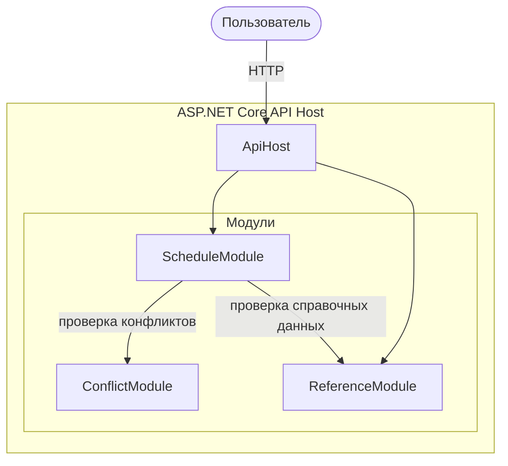

# 5. Архитектурная схема

Для проекта выбрана модульная архитектура.

Центральным модулем бизнес-процесса является `ScheduleModule`.

При создании заказа он:

1. получает справочные данные;
2. проверяет существование группы, преподавателя, дисциплины и аудитории;
3. проверяет конфликты;
4. сохраняет занятие;
5. при необходимости публикует расписание.